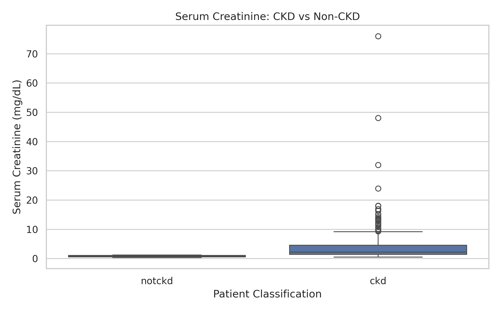
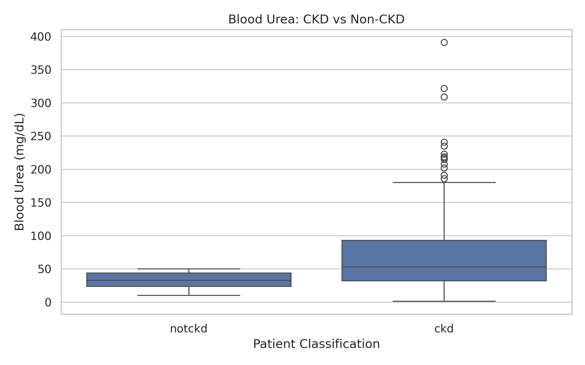
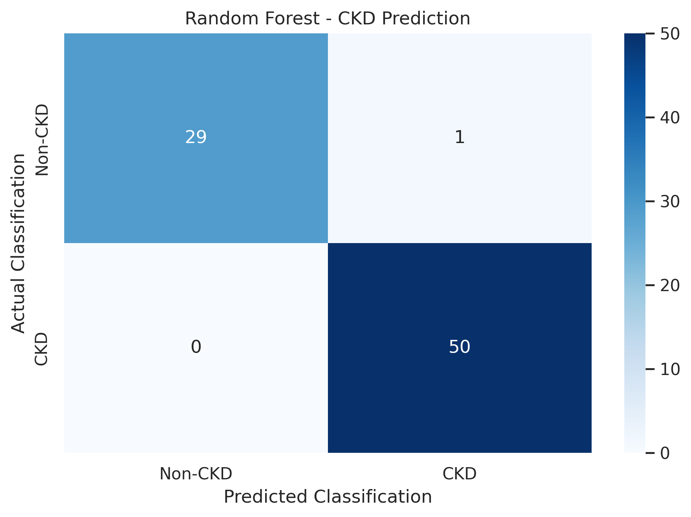
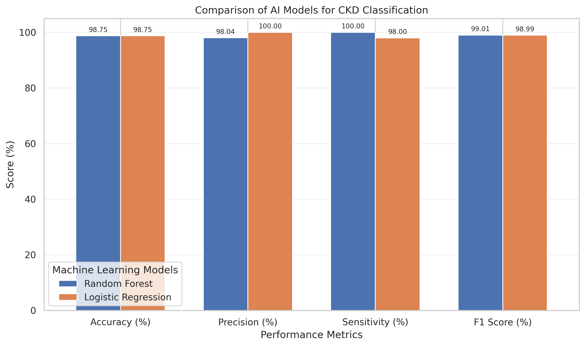

# AI-Based Chronic Kidney Disease Prediction Using Clinical Laboratory Parameters

## Project Overview

This project explores the application of Artificial Intelligence (AI) and Machine Learning in Medical Laboratory Sciences for the classification of Chronic Kidney Disease (CKD).

The project uses clinical laboratory parameters to train and evaluate two machine learning algorithms: Random Forest and Logistic Regression.

## Research Objectives

- To explore the application of AI in Medical Laboratory Sciences.
- To analyse clinical laboratory parameters associated with CKD.
- To develop machine learning models for CKD classification.
- To compare Random Forest and Logistic Regression.
- To evaluate accuracy, precision, sensitivity, and F1-score.

## Dataset Information

**Source:** UCI Machine Learning Repository

**Dataset:** Chronic Kidney Disease

**Total Records:** 400

**Input Features:** 24

**Classification:** CKD and Non-CKD

Dataset URL: https://archive.ics.uci.edu/dataset/336/chronic+kidney+disease

## Laboratory Parameters

The dataset contains:

- Serum Creatinine
- Blood Urea
- Haemoglobin
- Blood Glucose
- Sodium
- Potassium
- Packed Cell Volume
- White Blood Cell Count
- Red Blood Cell Count
- Urine Albumin

It also includes other laboratory and clinical variables.

## Methodology

1. Dataset collection from the UCI Machine Learning Repository.
2. Data cleaning and handling of missing values.
3. Exploratory data analysis using Python.
4. Laboratory parameter visualisation.
5. Splitting the data into 80% training and 20% testing sets.
6. Training Random Forest and Logistic Regression classifiers.
7. Evaluating model performance using classification metrics.

## Machine Learning Results

| Performance Metric | Random Forest | Logistic Regression |
|---|---|---|
| Accuracy | 98.75% | 98.75% |
| Precision | 98.04% | 100% |
| Sensitivity | 100% | 98% |
| F1-Score | 99.01% | 98.99% |

Both models achieved 98.75% accuracy on the held-out test dataset.

Random Forest achieved higher CKD sensitivity, while Logistic Regression achieved higher precision.

## Confusion Matrix Results

Random Forest correctly classified 79 out of 80 records.

- True Positives: 50
- True Negatives: 29
- False Positives: 1
- False Negatives: 0

## Data Visualisation

### Serum Creatinine Comparison

### Blood Urea Comparison

### Random Forest Confusion Matrix

### AI Model Performance Comparison

## Technologies Used

- Python
- Google Colab
- Pandas
- NumPy
- Scikit-learn
- Matplotlib
- Seaborn

## Limitations

The study used a relatively small dataset of 400 records and a single train-test split. Although both models achieved high test accuracy, these results may not generalise to other healthcare populations.

Further cross-validation, external validation, and clinical assessment would be required before considering real-world diagnostic applications.

This project is intended for academic and educational purposes only.

## References

UCI Machine Learning Repository. Chronic Kidney Disease Dataset.

https://archive.ics.uci.edu/dataset/336/chronic+kidney+disease

Chronic kidney disease prediction using boosting techniques based on clinical parameters. *PLOS ONE* (2023).

https://doi.org/10.1371/journal.pone.0295234

## Project Information

**Field:** Medical Laboratory Sciences

**University:** Riphah International University

**Degree:** MS in Medical Laboratory Sciences

**Project Area:** Artificial Intelligence in Medical Laboratory Technology
